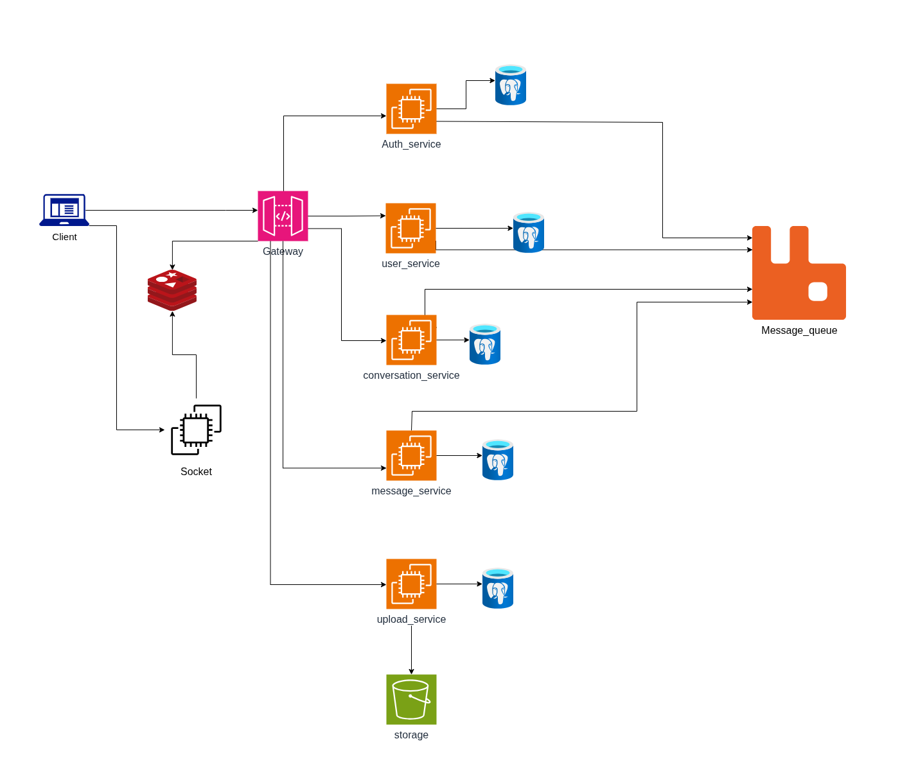

# WeTalk

WeTalk là ứng dụng nhắn tin thời gian thực, gồm frontend **Next.js** và backend **Go microservices** giao tiếp qua **RabbitMQ**.

## Tính năng

- Đăng ký, đăng nhập bằng JWT (access token + refresh token trong cookie httpOnly)
- Hội thoại 1-1 và nhóm: tạo, sửa, xoá, thêm và bớt thành viên
- Gửi, sửa, xoá tin nhắn theo thời gian thực qua Socket.IO
- Trạng thái online, đang gõ (typing), đã đọc và số tin chưa đọc
- Upload file lên Cloudflare R2
- Tài liệu API bằng Swagger UI

## Kiến trúc



| Thành phần | Thư mục | Cổng | Vai trò |
|---|---|---|---|
| Gateway | `backend/gateway` | 8080 | Xác thực JWT, CORS, chuyển tiếp request, Swagger |
| Auth | `backend/auth` | 8081 | Đăng ký, đăng nhập, refresh token |
| User | `backend/user` | 8082 | Hồ sơ người dùng |
| Conversation | `backend/conversation` | 8083 | Hội thoại và thành viên |
| Message | `backend/message` | 8084 | Tin nhắn, trạng thái đã đọc |
| Upload | `backend/upload` | 8085 | Upload file lên Cloudflare R2 |
| Socket | `backend/socket` | 9000 | Server Socket.IO, đẩy sự kiện realtime |
| Web | `web` | 3000 | Giao diện Next.js |

Một số điểm chính:

- Trình duyệt chỉ gọi **gateway**. Gateway kiểm tra JWT rồi thêm header `X-User-Id`. Các service phía sau tin vào header này và không kiểm tra lại token.
- Mỗi service có database Postgres riêng. Bảng được tạo bằng GORM `AutoMigrate`, không có file migration.
- Các service trao đổi sự kiện qua RabbitMQ. Ví dụ, khi có tin nhắn mới, message service publish `message.created`. Socket service gửi sự kiện đó tới trình duyệt của các thành viên, còn conversation service cập nhật tin nhắn cuối.
- Trình duyệt kết nối **thẳng** tới socket service, không qua gateway, và chỉ hỗ trợ transport `websocket`.

Chi tiết kiến trúc xem trong [CLAUDE.md](CLAUDE.md).

## Công nghệ

- **Backend:** Go 1.26+, Gin, GORM, PostgreSQL, RabbitMQ, Redis, gorilla/websocket
- **Frontend:** Next.js 16 (App Router), React 19, TypeScript, TanStack Query, react-hook-form + zod, Tailwind CSS v4, socket.io-client
- **Lưu trữ file:** Cloudflare R2 (tương thích S3)

## Cấu trúc thư mục

```
wetalk/
├── backend/
│   ├── gateway/        # API gateway + docs/openapi.yaml
│   ├── auth/
│   ├── user/
│   ├── conversation/
│   ├── message/
│   ├── upload/
│   └── socket/
├── web/                # Frontend Next.js
└── terraform/          # Hạ tầng (IaC), đang thử nghiệm
```

Mỗi service Go là một module riêng (có `go.mod`, `.env`, `.air.toml` riêng) và theo cùng một bố cục:

```
main/main.go → internal/router → handler → service → repository
```

## Cài đặt và chạy

### Yêu cầu

- Go 1.26 trở lên (`socket` và `upload` cần Go 1.27)
- Node.js 20 trở lên
- PostgreSQL, RabbitMQ, Redis
- [air](https://github.com/air-verse/air) để hot reload (không bắt buộc)

### 1. Chạy hạ tầng

Các file `docker-compose.yml` hiện đang để trống, nên bạn cần tự chạy Postgres, RabbitMQ và Redis. Ví dụ với Docker:

```bash
docker run -d --name wetalk-postgres -p 5432:5432 -e POSTGRES_PASSWORD=postgres postgres:16
docker run -d --name wetalk-rabbitmq -p 5672:5672 -p 15672:15672 rabbitmq:3-management
docker run -d --name wetalk-redis -p 6379:6379 redis:7
```

Sau đó tạo database cho từng service (`auth_db`, `user_db`, `conversation_db`, `message_db`, ...) theo giá trị `DB_NAME` trong file `.env` của service đó.

> Socket service đang cố định Redis ở `localhost:6379`.

### 2. Cấu hình biến môi trường

Trong mỗi thư mục service, sao chép file mẫu:

```bash
cd backend/<service>
cp .env.example .env
```

Lưu ý:

- Mọi service phải dùng **cùng một `JWT_SECRET`** với gateway.
- `message` và `socket` cần `CONVERSATION_SERVICE_URL` (mặc định `http://localhost:8083`).
- Gateway cần URL của các service: `AUTH_SERVICE_URL`, `USER_SERVICE_URL`, `CONVERSATION_SERVICE_URL`, `MESSAGE_SERVICE_URL`, `UPLOAD_SERVICE_URL`.
- Upload service cần thông tin Cloudflare R2: `R2_ACCOUNT_ID`, `R2_ACCESS_KEY_ID`, `R2_SECRET_ACCESS_KEY`, `R2_BUCKET`, `R2_PUBLIC_URL`. Muốn chạy local, đặt `R2_ENDPOINT` trỏ tới MinIO.
- Kiểm tra `PORT` trong từng file `.env` để khớp với bảng cổng ở trên.

Mọi service trừ gateway sẽ dừng ngay khi khởi động nếu thiếu file `.env` hoặc thiếu biến bắt buộc.

### 3. Chạy backend

Mở một terminal cho mỗi service:

```bash
cd backend/<service>
air                      # hot reload
# hoặc
go run ./main/main.go
```

Nên chạy `auth` và `user` trước, vì luồng đăng ký cần cả hai service cùng hoạt động.

### 4. Chạy frontend

```bash
cd web
npm install
npm run dev
```

Mở http://localhost:3000. Có thể đổi địa chỉ backend bằng biến môi trường trong `web/.env.local`:

```bash
NEXT_PUBLIC_API_URL=http://localhost:8080/api
NEXT_PUBLIC_SOCKET_URL=ws://localhost:9000
```

## Tài liệu API

Khi gateway đang chạy:

- Swagger UI: http://localhost:8080/swagger
- File OpenAPI: http://localhost:8080/swagger/openapi.yaml

File nguồn là [backend/gateway/docs/openapi.yaml](backend/gateway/docs/openapi.yaml), được viết tay. Hãy cập nhật file này mỗi khi thay đổi route, DTO hoặc dạng response.

Mọi response dùng chung một định dạng:

```json
{
  "success": true,
  "data": {},
  "error": { "code": "", "message": "" },
  "meta": {}
}
```

## Lệnh thường dùng

| Việc cần làm | Lệnh |
|---|---|
| Build một service | `go build ./...` |
| Chạy test | `go test ./...` |
| Lint frontend | `cd web && npm run lint` |
| Build frontend | `cd web && npm run build` |

Hiện test chỉ có ở `backend/socket/internal/socketio` và `backend/upload/internal/handler`. Frontend chưa có test.

## Thêm một service mới vào gateway

1. Thêm một mục vào `backend/gateway/main/services/service.go`.
2. Thêm biến URL vào `backend/gateway/config/config.go`.
3. Trong service mới, mount route dưới `/api/v1/<prefix>`, vì gateway chuyển tiếp nguyên đường dẫn.
4. Cập nhật `backend/gateway/docs/openapi.yaml`.
